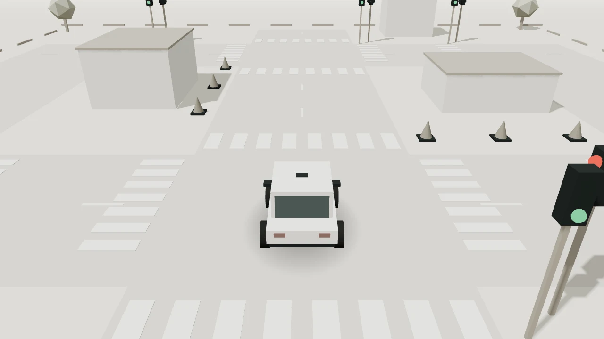

# Little Drive

An open-source Three.js driving playground by [gcusms](https://github.com/gcusms).

[在线体验 / Live demo](https://share.workstudioai.top/demos/car.html) · [作品广场 / Share](https://share.workstudioai.top/)



## 功能

- WASD、方向键或手机多点触控驾驶，前进、倒车、转向和刹车。
- 左键拖动旋转视角，右键拖动平移，滚轮平滑拉近 / 拉远，R 恢复默认跟随视角与缩放，不重置车辆。
- 跟随 / 俯视视角、暂停、车辆重置。
- 昼夜切换、6 种车身颜色、3 种轮胎样式，自动保存外观设置。
- 动态红黄绿灯、斑马线，最多 2 辆随机车辆和 3 名方块行人。
- 碰到车辆、行人、红绿灯杆或障碍物时停下，并提示换个方向；可以倒车离开。
- 其他车辆等待红灯；行人沿路边行走，等候过街时段，穿过斑马线后离开。
- 原生抗锯齿、柔和阴影、自适应高分辨率渲染。
- 中文 / English，图标控制与无障碍标签。

这是浏览器里的驾驶原型，不连接真实车辆。红绿灯控制随机车辆和行人通行；玩家目前不强制遵守信号，但无法穿过车辆、行人或灯杆。

## 本地运行 / Run locally

不需要构建，不需要 npm 安装。使用 HTTP 服务打开页面，不能直接双击 HTML 文件加载 ES Modules。

```bash
git clone https://github.com/GCUSMS-AI-ProJect/little_drive.git
cd little_drive
python3 -m http.server 8000 --bind 127.0.0.1
```

打开 http://127.0.0.1:8000/ 。Windows 可用 `py -m http.server 8000 --bind 127.0.0.1`。
浏览器需要支持 WebGL 2，建议启用硬件加速。Three.js、字体及预览图片均随项目提供。

## Controls

| Control | Action |
| --- | --- |
| W / ↑ | Forward |
| S / ↓ | Reverse |
| A / ←, D / → | Steer |
| Space | Brake |
| Left mouse drag | Orbit the camera |
| Right mouse drag | Pan the camera |
| Mouse wheel | Smoothly zoom in / out in any camera mode |
| R | Restore the default follow camera and zoom without resetting the car |
| P | Pause / resume the scene |
| Circular arrow button | Reset the car |

On mobile, hold the arrow and brake buttons. Multiple buttons can be held together. Hover over desktop icon buttons for descriptions.

## 项目结构 / Structure

```text
index.html                 Page and SVG controls
assets/car.js              Driving, camera, appearance and rendering
assets/car-traffic.js      Signal cycles, traffic and pixel-style pedestrians
assets/car.css             Responsive interface
assets/vendor/three-r180/  Three.js r180, MIT license
assets/fonts/              Noto Serif SC subset, SIL Open Font License
tests/traffic.mjs          Traffic simulation checks
```

交通与行人模型复用几何体并使用实例渲染；静态世界阴影缓存，动态小车使用接触阴影。
方块行人及像素面部由本项目代码生成，无需下载人物贴图。

## 验证 / Tests

With Node.js 20 or newer:

```bash
npm test
```

Tests simulate 180 seconds of traffic and check population limits, signal phases, red-light stops, pedestrian crossing and finite transforms. Collision tests cover rotated footprints, traffic light poles, vehicles, pedestrians, stopping and reversing away.

## 同步到 Share 网站

今后只修改本仓库。确认效果后执行：

```bash
python3 scripts/publish.py
```

脚本先检查交通逻辑与页面资源，再同步小车资源与页面到 `/home/ubuntu/pi-web/shop/`，自动更新缓存版本。它不会修改广场页面或其他作品，也不会自动推送 GitHub。
其他服务器可用 `--target /path/to/share` 指定发布目录。

## Contributing

欢迎通过 Issues 分享问题、想法和改进建议，或通过 Pull Request 贡献代码。
Please include steps to reproduce a bug, browser/device information and a screenshot when relevant.

## License

原创代码采用 MIT 许可证，见 [LICENSE](LICENSE)。Three.js 的 MIT 许可证位于 `assets/vendor/three-r180/LICENSE`，字体许可证位于 `assets/fonts/OFL.txt`。不得将第三方依赖的许可归属替换为本项目归属。
